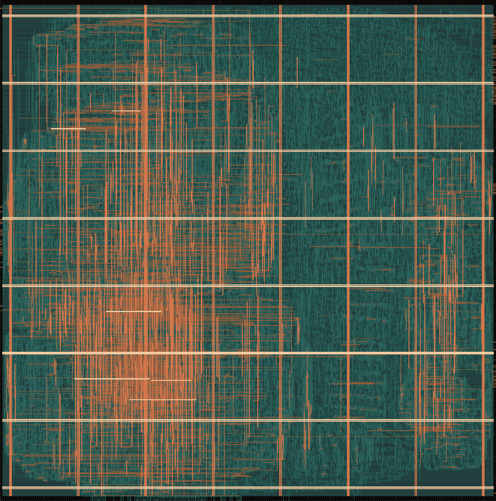

# ChromaPS

**[Project page with the interactive die view and relighting demo → https://alainchen6.github.io/ChromaPS/](https://alainchen6.github.io/ChromaPS/)**

A single-shot colour-multiplexed photometric stereo core, taken from RTL to
GDSII on an open-source flow.

Three directional lights — red, green and blue — illuminate the object at the
same time, so one colour photograph carries three independent shading
measurements per pixel. A fixed 3×3 calibration matrix untangles them, and the
core turns each pixel into a surface normal scaled by its albedo, a confidence
flag, and two re-lit images under lamps that were never switched on.



| | |
|---|---|
| Process | SkyWater sky130A, high-density library |
| Flow | LibreLane 2.4.2, RTL → GDSII, DRC and LVS clean |
| Area | 1.245 mm² core, 1.283 mm² die |
| Cells | 77,268 standard cells, 1.72 m of routed metal |
| Clock | 25 ns closed at all nine corners (40 MHz signed off, ≈85 MHz typical) |
| Throughput | one pixel per clock, 50 cycles of latency, no on-chip memory |
| Verification | 8 synthetic cases + 320,000 pixels of real photographs, RTL bit-exact against the model |

The companion project page is built from `docs/` and published at
<https://alainchen6.github.io/ChromaPS/>.

## How it works

```
m   = [ I_R, I_G, I_B ]ᵀ
g   = A · m              A = (C · S · L)⁻¹, folded offline into one 3×3 matrix
ρ   = |g|                albedo
n   = g / ρ              unit normal
I_v = max(0, g · l_v)    re-lighting, no normalisation needed
```

`A` absorbs the camera's spectral response, the LED spectra and the light
directions, so a different rig only needs a new calibration — the silicon stays
the same. The re-lighting identity is the useful accident: the dot product with
a virtual lamp acts on `g` directly, which is why an extra light costs three
multipliers and nothing else.

Every operation is integer: the square root and the reciprocal are exact, so the
RTL and the Python model can be compared byte for byte.

## Verification

`make test` runs eight cases through the same chain: a ray tracer generates the
stimulus, an independent fixed-point model produces the expected output, the RTL
simulates the frame, and the five output channels are compared byte by byte.
The angular error is measured against the ray tracer's own normals, which
neither the model nor the RTL has seen.

| case | what it exercises | RTL vs model | confident | mean err | p95 |
|---|---|---|---|---|---|
| plate | embossed surface with printed albedo | bit-exact | 100% | 0.31° | 0.67° |
| sphere | ring illumination around the lens | bit-exact | 94% | 0.22° | 0.40° |
| bumps | high-frequency relief, uniform albedo | bit-exact | 100% | 0.23° | 0.43° |
| tilted | a different calibration matrix | bit-exact | 100% | 0.39° | 0.85° |
| noise | sensor noise added to the capture | bit-exact | 100% | 5.25° | 12.7° |
| dark | 30% exposure | bit-exact | 50% | 0.53° | 0.95° |
| studio | specular glints, vignetting, grain | bit-exact | 99.9% | 1.54° | 3.78° |
| edge | saturation, shadow, zero signal | bit-exact | 0% | — | — |

The report lands in `out/report.md`. Two rows are worth a note. `noise` stays
bit-exact in arithmetic but the normals move, and the confidence channel does
not catch it — that is the honest result. `studio` adds specular highlights, and
the error grows from 0.3° to 1.5° because the model assumes a Lambertian
surface.

## Real photographs

The [Harvard photometric stereo dataset](http://vision.seas.harvard.edu/qsfs/Data.html)
provides twenty calibrated lights and ground-truth normals per object. Three of
its frames are stacked into one RGB image and pushed through the fixed-point
pipeline:

```
object covers 53.5% of the frame, 49.7% low confidence (almost all background)
float least squares : median 2.79°   mean 5.00°
this core, 8-bit    : median 2.83°   mean 5.05°   p95 18.63°
RTL vs model        : 320,000 pixels, all five channels bit-exact
```

```bash
curl -O http://vision.seas.harvard.edu/qsfs/PSData.zip     # 117 MB
unzip PSData.zip
python3 model/real.py --data PSData/cat --out stim/real
```

The dataset itself is not committed; the repository ships `model/real.py` and
the resulting figure.

## Bring your own photograph

No special hardware is needed: a phone and three coloured LEDs, or three
photographs each taken with one colour, are enough.

```bash
# one frame, all three lights at once
python3 model/photo.py --single my_photo.jpg --out stim/mine

# three frames, one light each
python3 model/photo.py --triple red.jpg green.jpg blue.jpg --out stim/mine
```

The script crops to 320×240, writes `stim/mine/`, and runs the numpy model
immediately so `out/mine_{normal,albedo,relight0}.ppm` can be inspected without
waiting for the RTL. Pass `--calib` with nine Q2.13 integers if the lamp
geometry differs.

## Power

The flow reports OpenSTA's default-activity power at the typical corner: **0.85 W**,
split into 0.36 W internal, 0.49 W switching and 0.7 µW leakage — about 21 nJ per
pixel at 40 Mpixel/s. Every net is assumed to toggle at 0.1 per cycle, so this is
a ceiling rather than a measurement.

A gate-level run gives the real activity instead (`tb/tb_power.sv` dumps a VCD,
`model/power.py` counts it): 58,076 nets, 160 cycles, 283,967 transitions, or
**0.031 transitions per net per cycle** — a third of the default assumption. The
true dynamic power is therefore in the 0.3–0.5 W range.

A waveform-annotated sign-off number would need one more step: OpenSTA's
`read_vcd` matches by pin name, so a net-level VCD only annotates the 189
top-level ports; the 58k internal nets would require a pin-level dump of 131k
instances. LibreLane 2.4 has no VCD power step.

## Throughput

The same arithmetic, five ways (`python3 model/bench.py` reproduces the table):

| implementation | throughput | 320×240 frames |
|---|---|---|
| ChromaPS, typical corner ≈85 MHz | 85 Mpixel/s | 1,107 fps |
| ChromaPS, signed off at 40 MHz | 40 Mpixel/s | 521 fps |
| numpy on a laptop | 5.8 Mpixel/s | 75 fps |
| Cortex-M4 @168 MHz (estimate, 250 cycles/pixel) | 0.67 Mpixel/s | 8.7 fps |
| scalar Python | 0.18 Mpixel/s | 2.3 fps |

640×480 at 30 fps needs 9.2 Mpixel/s, so the signed-off core has 4.3× headroom,
while a 168 MHz Cortex-M4 would need about fourteen of itself.

## Quick start

```bash
make test      # eight cases end to end: ray tracer → model → RTL → compare
make model     # ray tracer and fixed-point model only
make rtl       # RTL simulation
make compare   # byte comparison
make gls       # zero-delay gate-level run on a 64×64 slice
make pnr       # LibreLane, RTL → GDSII (~40 minutes)
```

Dependencies: `iverilog`/`vvp`, Python 3 with numpy and matplotlib, and
LibreLane from nix. The gate-level targets need one PnR run first, to provide
`src/runs/<tag>/final/pnl` and `sdf`.

## Repository layout

```
src/       RTL (chromaps, mat3, isqrt16, recip) and LibreLane configuration
tb/        RTL, gate-level and power testbenches
model/     ray tracer, fixed-point model, comparison, photo import, figures
tests/     the eight-case runner
docs/      companion project page (GitHub Pages root) and its images
```

`stim/`, `out/`, `build/` and `src/runs/` are generated and git-ignored.

## Design notes

- **Single shot.** Three measurements are encoded in the R, G and B channels;
  no frame synchronisation and no moving parts.
- **Re-lighting identity.** `I_v = g·l_v` removes the normalisation path
  entirely.
- **All integer.** The square root and reciprocal are exact, which is what makes
  the byte-for-byte comparison meaningful.
- **Confidence.** Shadowed, saturated and weak pixels are flagged instead of
  producing a wrong normal.
- **No on-chip memory.** One pixel per clock, 50 cycles of latency, no line
  buffer.

## License

Apache-2.0, see [LICENSE](LICENSE).
